# Last Wish - Unity

**Último Deseo**, migrado desde el proyecto Python/Pygame a **Unity 6.3 LTS,
6000.3.6f1**. Todas las pantallas, reglas y efectos del original están portados a
C#; el estado y las diferencias conocidas están en `docs/port-status.md`.

## Abrir y jugar

1. Agrega esta carpeta (`C:/Users/USER/Desktop/web/unity/last-wish-unity`) en Unity Hub.
2. Ábrela con **6000.3.6f1** y espera la importación inicial.
3. Elige **Last Wish > Jugar** en el menú superior (abre `Assets/Scenes/Bootstrap.unity`
   y pulsa Play en la pestaña Game).

El juego se dibuja al ejecutarse: la pestaña **Scene** se ve vacía antes de Play.
La pantalla de carga aparece al pulsar Play o al abrir una build. El juego no
necesita Python.

## La partida

Igual que el original: menú (Jugar, Ajustes, Pruebas, Salir) → elegir personaje y
semilla → mapa por pisos con combate, élite, tesoro, tienda y sobres, suceso, Brujo,
gachapón, altar de purga y jefe → recompensas → siguiente piso. La vida, el oro, el
mazo y las reliquias pasan de sala en sala. Como en el original, no hay guardado:
**Pausa · Esc > Abandonar partida** vuelve al menú.

## Controles (los del original)

| Acción | Control |
|---|---|
| Jugar una carta | Arrastrarla fuera de la mano (o clic para sujetarla y clic de nuevo); sobre un enemigo si apunta a uno |
| Teclado | 1–9 toma una carta, ←/→/Tab cambia de objetivo, Enter/Espacio la juega |
| Cancelar | Clic derecho o Esc |
| Terminar turno | Botón o E |
| Ver todo de un enemigo / del héroe | Clic derecho, mantener pulsado o I |
| Elementos y reacciones (Mago) | Botón R o tecla R |
| Historial del combate | Tira de la izquierda: rueda, arrastrar o tocar |
| Hoja del héroe | Botón del casco o C |
| Pausa | Botón o Esc |
| Mostrar FPS | Ajustes |

## Estructura

```text
Assets/Scripts/Domain/        Reglas C# puras (sin UnityEngine): combate, cartas, reliquias, enemigos (originales y de los pisos 1 y 2), run
Assets/Scripts/Presentation/  Escenas, UI y efectos del original sobre un lienzo virtual 1280×720 (C# puro)
Assets/Scripts/Runtime/       Unity: GameBootstrap (bucle de main.py), backend de dibujo, entrada, audio, archivos
Assets/Editor/                Importador de pixel art, configuración y build
Assets/Resources/Game/        PNG, metadatos, fuentes y audio originales
Assets/Scenes/Bootstrap.unity Escena de entrada
Assets/Tests/EditMode/        Reglas y paridad con el motor Python
Assets/Tests/PlayMode/        El juego completo con entrada simulada y capturas
Tools/                        Exportadores desde el repositorio Python y validación sin editor
supabase/                     Telemetría de poder: Supabase local (Docker), esquema SQL y pruebas
```

El backend de Unity mete todo el frame en una sola malla dinámica (submallas solo
al cambiar de textura o de mezcla) ejecutada por un command buffer; las caras de
carta se componen una vez en texturas fuera de pantalla y se reutilizan, y el
lienzo se presenta escalado a la ventana con bandas negras como el `Viewport`
original. En estado estable no se reserva memoria por frame.

## Pruebas y build

En Unity: **Window > General > Test Runner**, pestañas EditMode y PlayMode. Las
pruebas PlayMode guardan capturas del lienzo en `TestResults/`.
**Last Wish > Build Windows** genera `Builds/Windows/LastWish.exe` (ignorado por Git).

```powershell
$editor = 'C:/Program Files/Unity/Hub/Editor/6000.3.6f1/Editor/Unity.exe'
$project = (Get-Location).Path
& $editor -batchmode -nographics -projectPath $project -executeMethod LastWish.Editor.ProjectSetup.Configure -quit -logFile Logs/import.log
& $editor -batchmode -nographics -projectPath $project -runTests -testPlatform EditMode -testResults TestResults/editmode.xml -logFile Logs/editmode.log
& $editor -batchmode -projectPath $project -runTests -testPlatform PlayMode -testResults TestResults/playmode.xml -logFile Logs/playmode.log
```

Los comandos de tests no llevan `-quit`: el Test Runner cierra el editor. Revisa
los XML y los logs, no solo el código de salida. `Tools/Validate.ps1` compila todo
contra las DLL de Unity y ejecuta los casos del dominio con .NET; no sustituye al
Test Runner.

Herramientas opcionales de migración (se ejecutan con el Python del repositorio original):

```powershell
python Tools/ExportPythonCatalog.py --source-dir RUTA_PYTHON --output docs/migration/python-catalog.json
python Tools/ExportNumericCards.py --source-dir RUTA_PYTHON --output-dir .
python Tools/ExportEnemyPatterns.py --source-dir RUTA_PYTHON --output-dir .
python Tools/ImportPythonAssets.py --source-dir RUTA_PYTHON
python Tools/ExportPresentationData.py --source-dir RUTA_PYTHON
python Tools/ExportCardFx.py --source-dir RUTA_PYTHON
python Tools/ExportPixelFonts.py --source-dir RUTA_PYTHON
```

Sonidos propios del gachapón (no existen en el original; solo la biblioteca estándar de Python):

```powershell
python Tools/GenerateGachaAudio.py                      # escribe Assets/Resources/Game/Audio/gacha_*.wav y sus .meta
python Tools/GenerateGachaAudio.py --check              # comprueba que los WAV coinciden con las recetas
python Tools/GenerateGachaAudio.py --preview TestResults/audio   # mezcla tiradas completas para escucharlas
```

El arte original se conserva sin redibujar. Consulta `THIRD_PARTY_NOTICES.md`.

## Telemetría de poder

Cada partida registra qué hacen las cartas, las reliquias y los encuentros (jugadas, daño y
bloqueo por maná, vida perdida frente a la media del piso, elecciones, jefes que matan) y la
guarda en Supabase para consultarla con SQL. Durante el combate solo se suman enteros; el JSON
se escribe en disco en segundo plano y se sube sin bloquear el juego, incluso sin conexión.

```powershell
powershell -ExecutionPolicy Bypass -File Tools/Telemetry/LocalSupabase.ps1 start   # Docker Desktop + Node.js
```

Studio local: <http://127.0.0.1:54323>. Consultas, métricas y paso a producción: `docs/telemetry.md`.

## Estilo visual

Todo el arte nuevo sigue **`docs/art-style.md`** (decisión del 27-10-2026, sustituye a las pautas anteriores): pixel art
pequeño y nítido con la luz en una capa aparte, noche fría con magia cian/violeta y acentos cálidos, estrellas de 4
puntas, motas y bucles de anticipación → impacto → disipación. Incluye el prompt original, la paleta, la técnica de
dibujo y cómo se hacen las partículas.

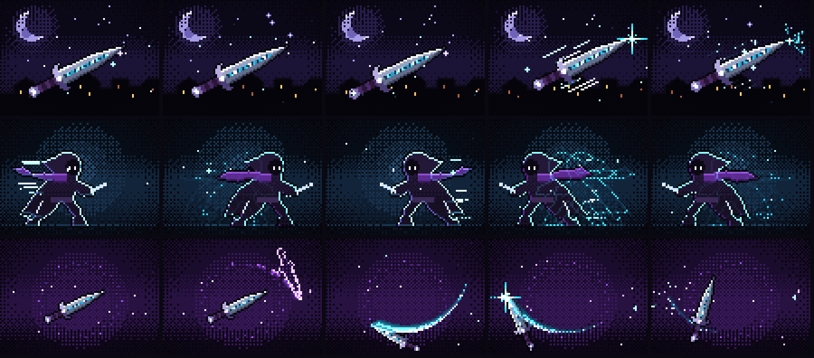

## Ilustraciones de las cartas

Cada carta tiene su propia ilustración en la ventana del marco (`Cards/Art/<id>.png`, 44×32 píxeles a ×4),
en lugar del icono genérico de su tipo. Se componen con tiles CC0 de Dungeon Crawl Stone Soup (los mismos de
los iconos genéricos) y efectos de píxel; Espora y Moho conservan su arte original:

```powershell
python Tools/GenerateCardArt.py            # escribe las 176 ilustraciones y la lista "art" de Cards/layout.json
python Tools/GenerateCardArt.py --check    # comprueba que coinciden con el repositorio
python Tools/GenerateCardArt.py --only a_tajo --preview TestResults/card-art   # hoja de contacto para revisar
```

Lee los tiles del repositorio Python (`--source-dir`, por defecto `../../python/last-wish`).

### Ilustraciones animadas (cartas básicas de los tres héroes y todas las de la Pícara y la Guerrera)

Puñalada, Esquiva y Finta (Pícara), Proyectil Arcano, Égida y Chispa Ígnea (Mago) y Espadazo, Bloqueo y Guardia Férrea
(Guerrera) tienen ilustración animada en el juego (88×64, 24 fotogramas a 12 fps; las de la Pícara son las del VFX Lab,
`Tools/VfxLab/rogue_art.py`; las del Mago, `Tools/VfxLab/mage_art.py`, son el hechizo en sí, y las de la Guerrera,
`Tools/VfxLab/warrior_art.py`, su espada y su escudo, sin personaje) en la ventana de arte de la carta normal, con un
halo de luz aditivo y destellos y motas en vivo. Se ven en la mano (también inclinadas y al sostenerlas), el mazo,
recompensas y tienda; donde la carta es una imagen fija (vuelo al robar, apertura de sobres) se ve su fotograma fijo.
El marco, el texto y los números no cambian.

Todo el botín de la Pícara también la tiene (3-11-2026: sus 66 cartas están animadas; sin personaje: sus dagas, sus
cartas, sus venenos, su humo, su capa, sus botas y sus dados). `Tools/VfxLab/rogue_pool_art.py`: Pinchazo, Tajo Veloz, Lanzar la Daga, Lluvia de Dagas, Cuchillada Errante,
Marcar Objetivo, Abrir la Guardia, Corte y Guardia, Afilar y Carterista. `Tools/VfxLab/rogue_pool_art_2.py`: Chatarra,
Deshacerse, Finta Doble, Quiebro, Tirar y Cortar, Hoja Envenenada, Veneno, Muro de Humo, Contraataque y Golpe de
Gracia. `Tools/VfxLab/rogue_pool_art_3.py`: Corte Rápido, Tajo, Puñalada Trapera, Golpe Desesperado, Instinto, Juego de
Manos, Manto Raído, Reflejos, Escudo Reactivo y Guardia Evasiva. `Tools/VfxLab/rogue_pool_art_4.py`: Agilidad, Señuelo,
Sombra Esquiva, Capa de Sombras, Corte Afortunado, Hoja Única, Ráfaga de Cortes, Tirar los Dados, Torbellino y Dagas
Ocultas (las tres poco comunes que quedaban y siete raras). `Tools/VfxLab/rogue_pool_art_5.py`: Paso Atrás, Rodar,
Rebuscar, Vaciar Bolsillos, Abanico de Cuchillas, Astucia, Danza de Sombras, Estilo Propio, Estocada Oportuna, Fortuna
Audaz, Maestra de Dagas y Preparación. `Tools/VfxLab/rogue_pool_art_6.py`: Rapiña, Sombra Gemela, Asesina, Cadena
Perfecta, Lluvia de Golpes, Mazo Impecable, Mil Cortes, Nada que Perder, Ritmo Letal, Tormenta de Acero y Tormenta de
Veneno. Con eso la Pícara tiene sus 66 cartas animadas (72 de 178 en todo el juego).

Todo el botín de la Guerrera también (8-11-2026: sus 50 cartas están animadas; sin personaje: su espada, su escudo,
su hacha, su cuerno, su guantelete, su yelmo vacío en un poste, su coraza en un soporte, su martillo, y su vida como
un corazón de cristal). Su vocabulario se repite en todas: perder vida = una gota de su sangre que cae desde arriba;
Furia = esa sangre en el arma (runas y aura carmesí); Aguante = el escudo que ya tiene (contorno azul tenue) y un pulso
dorado desde su gema; Fuerza = cheurones carmesí que suben; curarse = cruces verdes y el corazón que se llena; escudo
= el rombo azul del juego. `Tools/VfxLab/warrior_pool_art.py`: las 9 comunes (Corte Sangriento, Embate Firme, Escudo de
Sangre, Golpe Doble, Herida Abierta, Muro de Acero, Postura Firme, Tajo Brutal, Vendaje). `warrior_pool_art_2.py`: las 10
poco comunes (Fortaleza Interior, Grito de Batalla, Grito de Guerra, Hachazo Temerario, Puño de Hierro, Respiro, Rugido,
Sangre Hirviente, Sangría, Sed de Batalla). `warrior_pool_art_3.py`: las 14 raras (Conjuro de Combate, Coraza Viva,
Golpe Pesado, Golpe Total, Golpe de Escudo, Martillo Sísmico, Pacto de Hierro, Regeneración, Represalia, Sacrificio,
Segunda Piel, Torbellino de Acero, Torre, Transfusión). `warrior_pool_art_4.py`: las 6 épicas y 8 legendarias (Baluarte,
Furia Desatada, Gran Golpe, Gran Muralla, Ira Carmesí, Piel de Acero, Bastión, Berserker, Doblar Escudo, Ejecución,
Escudo Impenetrable, Golpe Vampírico, Muralla Infranqueable, Voluntad de Hierro). En total, 119 de 178 cartas animadas.

```powershell
python Tools/VfxLab/export_game_card_art.py           # escribe Cards/Anim (hojas, halos y anim.json)
python Tools/VfxLab/export_game_card_art.py --check   # comprueba que coinciden con el generador
python Tools/VfxLab/card_art_status.py                # rehace docs/card-art.md (qué cartas ya están animadas)
```

La lista de todas las cartas con su estado (animada o no) está en `docs/card-art.md`, generada a partir de
`Data/cards.json` y `Cards/Anim/anim.json`.

Código: `Presentation/Cards/CardArtAnimation.cs`. Pruebas: `CardArtAnimationTests` (EditMode), `RogueCardArtTests`,
`RogueLootCardArtTests`, `MageCardArtTests` y `WarriorCardArtTests` (PlayMode, capturas `TestResults/rogue-*.png`,
`TestResults/rogue-loot-*.png`, `TestResults/mage-*.png` y `TestResults/warrior-*.png`). Una carta nueva con animación solo necesita su entrada en el exportador.

### La Pícara en combate (sprite en el estilo de sus cartas)

La hoja de la Pícara (`Heroes/rogue_96|192`, halo `rogue_halo_96`, `rogue.json`) está redibujada en el estilo de
`docs/art-style.md`: la pícara encapuchada de Esquiva como **una sola silueta** escaneada fila a fila (nunca por
piezas), a 12 fps. Reposo de 2 s; ataque = Puñalada, guardia = Esquiva, habilidad = Finta; daño y muerte (de
rodillas, la daga clavada en el suelo). En combate, el reposo del héroe gira con su propio ciclo.

```powershell
python Tools/VfxLab/export_hero_art.py --preview TestResults/rogue-hero-preview   # escribe la hoja + GIFs
python Tools/VfxLab/export_hero_art.py --check                                   # coincide con el generador y es una sola masa
```

Pruebas: `RogueHeroArtTests` (EditMode: tiempos, eventos, halo; PlayMode: capturas `TestResults/rogue-hero-*.png`).

> **Pendiente de rehacer (30-10-2026):** la hoja de la Pícara lleva el brazo y la daga dibujados encima del cuerpo,
> que cuenta como técnica por piezas y el usuario la prohibió; se rehará con el método del Mago (`docs/art-style.md` §3.1).

### El Mago en combate (dibujado con código en HTML)

`Tools/VfxLab/mage_hero.html` es a la vez la página para verlo (ábrela en el navegador: reposo, ataque, guardia, daño,
habilidad y muerte, con halo y cada fotograma a tamaño de combate) y la fuente de su hoja (`Heroes/mage_96|192`, halo
`mage_halo_96`, `mage.json`). Cada fotograma dibuja con código la figura entera —sombrero, cara en sombra con ojos
cian, pelo plateado, túnica azul con ribetes dorados, capa, la manga que cuelga de la esclavina, la mano y el bastón con
su cristal— como **una sola silueta** con un único contorno, con su pose escrita en una tabla; no hay piezas ni nada que
gire al reproducir. Ataque = Proyectil Arcano (el rayo sale del cristal), guardia = Égida (cúpula hexagonal), habilidad
= círculo rúnico; muerte de rodillas apoyado en el bastón. Es el método obligatorio para todos los personajes y enemigos
(`docs/art-style.md` §3.1).

```powershell
python Tools/VfxLab/export_hero_art.py --hero mage --preview TestResults/mage-hero-preview   # necesita Node
python Tools/VfxLab/export_hero_art.py --check
```

Pruebas: `MageHeroArtTests` (EditMode y PlayMode, capturas `TestResults/mage-hero-*.png`).

### La Guerrera en combate (dibujada con código en HTML)

`Tools/VfxLab/warrior_hero.html` (31-10-2026) es la página para verla y la fuente de su hoja (`Heroes/warrior_96|192`,
halo `warrior_halo_96`, `warrior.json`), con el mismo método que el Mago. Cada fotograma dibuja la figura entera como
**una sola silueta**: yelmo cerrado con visera en T (los ojos cian brillan dentro: la cara queda cubierta como la del
Mago y la Pícara), penacho carmesí, trenza platino, hombreras y peto de acero con ribetes dorados, tabardo carmesí,
escarcelas, grebas, escudo heater carmesí en el brazo lejano y espada larga con runas; sin capa. Ataque = Espadazo
(corte ascendente con media luna cian), guardia = Bloqueo / Guardia Férrea (alza el escudo y crece de él un escudo de
placas de luz), habilidad = Furia (aura carmesí); muerte de rodillas sobre la espada clavada. Sustituye a la hoja
anterior (72 columnas, sin halo).

```powershell
python Tools/VfxLab/export_hero_art.py --hero warrior --preview TestResults/warrior-hero-preview   # necesita Node
python Tools/VfxLab/export_hero_art.py --check
```

Pruebas: `WarriorHeroArtTests` (EditMode y PlayMode, capturas `TestResults/warrior-hero-*.png`).

### Enemigos dibujados con código en HTML

Los enemigos se rehacen con el mismo método que los héroes, una página por enemigo en `Tools/VfxLab/enemies/`. El primero
es **el Espectro** (12-11-2026, `wraith.html`): una sola silueta por fotograma con capucha, vacío con ojos de ectoplasma,
capa que se deshace en jirones, llama del alma y mangas de campana con garras de hueso; las mangas y los dedos tienen su
propia forma en cada fotograma (barrido, tela que llega tarde), nada de piezas que giran. Reposo, Zarpazo Espectral,
daño, Lamento y muerte que se disuelve, con halo. **La Babosa Ácida** (`slime.html`): gel oscuro con núcleo de ácido y un
yelmo oxidado hundido en la coronilla; Golpe Viscoso, Escupitajo Ácido, Corroer, daño y muerte que se derrite. **El Gusano
de Tumba** (`worm.html`, con su mortaja y su boca de lamprea), **el Ojo Vigilante** (`eye.html`, una celada con un ojo
magenta y tentáculos) y **el Cráneo Ígneo** (`skull.html`, yelmo con cuernos y melena de fuego). Los demás enemigos siguen
con sus hojas anteriores hasta rehacerlos.

```powershell
python Tools/VfxLab/export_enemy_art.py --enemy wraith --preview TestResults/enemy-preview   # necesita Node
python Tools/VfxLab/export_enemy_art.py --check
```

Pruebas: `WraithArtTests` y `HtmlEnemyArtTests` (EditMode).

## VFX Lab (prueba de efectos y cartas de la Pícara)

Escena aislada en `Assets/VfxLab` para validar partículas brillantes en pixel art (inspiración Core Keeper/Noita)
sin tocar el juego: un proyectil arcano cian por capas (núcleo, halo, chispas, estelas, impacto) y las tres cartas
básicas de la Pícara con ilustraciones animadas nuevas y partículas. Funciona sobre el Built-in Render Pipeline del
proyecto: capa de píxeles 640×360 HDR, bloom propio separado del núcleo nítido, luz 2D simulada y *pooling*.

- **Last Wish > VFX Lab > Jugar VFX Lab** — 1-3 o clic juegan cartas, Espacio lanza, S prueba de estrés, B bloom, T cámara lenta.
- **Last Wish > VFX Lab > Construir y capturar fotogramas** — capturas en `TestResults/vfxlab/`.
- Arte: `python Tools/VfxLab/generate_vfxlab_art.py`. Detalle, parámetros y pendientes: `docs/vfx-lab.md`.

## Enemigos nuevos del piso 1

La partida del menú añade al piso 1 diecisiete enemigos que no existen en el original:
- 7 normales, 3 esbirros invocables y 3 élites.
- 4 jefes repartidos en 3 combates, uno de ellos la pareja Los Hermanos Lápida.
- 6 grupos nuevos.

Mecánicas nuevas:
- Invocación con un máximo de 3 enemigos en pantalla. Los esbirros no dan oro.
- Pinchos, Desvío, Blindaje, Carroña, Buche, Carga/Aturdido y Vigilancia.
- Combos de jefe contra estrategias: robar Fuerza, arrancar escudo, mudar el veneno y los elementos, castigar jugar muchas cartas.

Las pruebas de paridad siguen usando el contenido original (`EnemyRoster.Original`). El bestiario completo está en `docs/enemies.md`.
Las hojas de sprites nuevas se generan así:

```powershell
python Tools/GenerateEnemyArt.py           # escribe las 17 hojas (Python 3.11 + Pillow 11)
python Tools/GenerateEnemyArt.py --check   # comprueba que coinciden con el repositorio
```

## Enemigos nuevos del piso 2

La partida del menú también tiene un piso 2 propio, con quince enemigos que no existen en el original:
- 6 normales, 3 esbirros y 3 élites.
- 3 jefes nuevos (El Nigromante, La Hidra de la Cisterna y La Reina de los Espejos), que sustituyen al Señor de la Cripta.
- 6 grupos nuevos, mezclados con los enemigos originales.

Mecánicas nuevas:
- Amparo, Rito, Rencor, Cicatrización, Cabezas, Reflejo y Ansia de Sangre en los enemigos.
- Sangrado y Necrosis, dos perjuicios nuevos para el héroe.
- Ilusiones que desaparecen con su invocadora y sacrificios de esbirros (Ofrenda Oscura).
- Combos de jefe contra estrategias: anular la curación, castigar los golpes enormes, devolver el veneno y los perjuicios, y regenerarse salvo con Fuego o Veneno.

En Pruebas, los índices nuevos (combates 31-42, élites 9-11 y jefes 7-9) fuerzan ese contenido también en los pisos 1 y 3.
Detalle y números en `docs/enemies.md`.

```powershell
python Tools/GenerateEnemyArtFloor2.py           # escribe las 15 hojas del piso 2 (Python 3.10+ y Pillow 11+)
python Tools/GenerateEnemyArtFloor2.py --check   # comprueba que coinciden con el repositorio
```

## Enemigos nuevos del piso 3

El piso 3 de la partida del menú es una ciudadela helada con quince enemigos nuevos:
- 6 normales (uno, el Abanderado, solo sale acompañado), 3 esbirros y 3 élites.
- 3 jefes nuevos (El Rey Liche con su Filacteria, El Relojero y La Dragona de Escarcha), que sustituyen al Señor de la Cripta.
- 6 grupos nuevos, mezclados con los enemigos originales. Una de cada cuatro peleas de pareja trae un tercer enemigo, como en el original.

Mecánicas nuevas:
- Pendón (aura que da Inspiración a los aliados), Cólera, Inmortal y Cuerda en los enemigos.
- Ataques Perforantes que ignoran el escudo y Rebobinar, que recupera la vida perdida en tu turno.
- Agotamiento y Congelación, dos perjuicios nuevos para el héroe: menos maná, y vida perdida por cada carta que te quede en la mano.

Los pisos 4 en adelante siguen como en el original. En Pruebas, los índices del piso 3 (combates 43-54, élites 12-14 y jefes
10-12) fuerzan ese contenido en cualquiera de los pisos 1-3. Detalle y números en `docs/enemies.md`.

```powershell
python Tools/GenerateEnemyArtFloor3.py           # escribe las 15 hojas del piso 3 (Python 3.10+ y Pillow 11+)
python Tools/GenerateEnemyArtFloor3.py --check   # comprueba que coinciden con el repositorio
```

## Capturas

Renderizadas con el verificador fuera de línea a partir de los mismos comandos de
dibujo que ejecuta Unity:

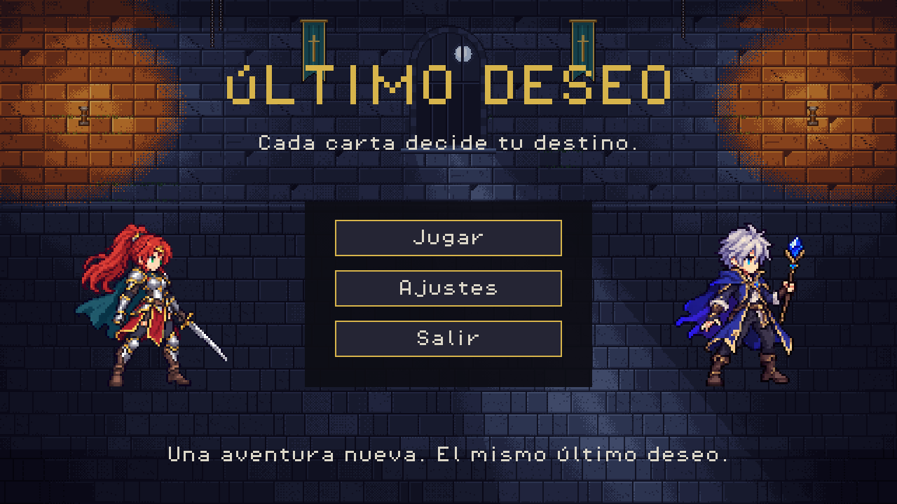

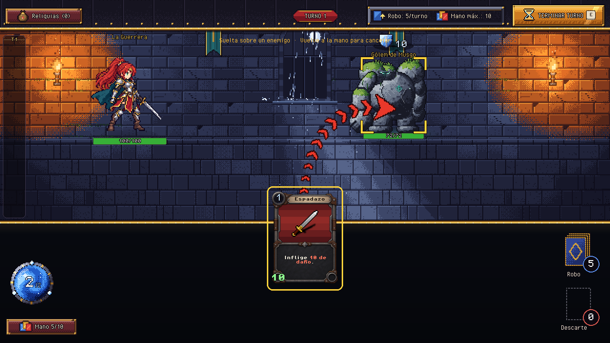

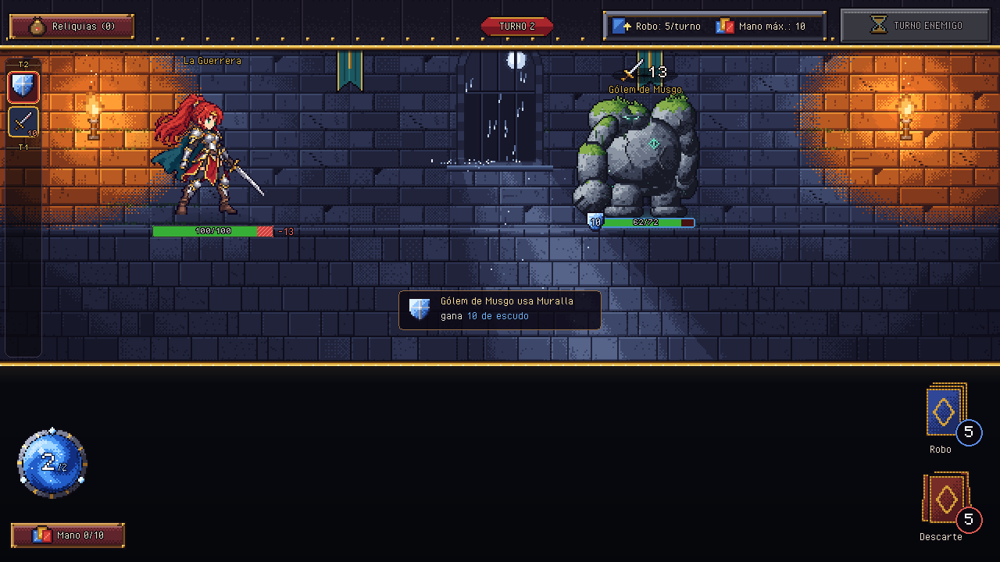

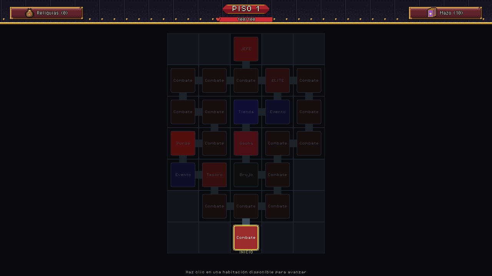

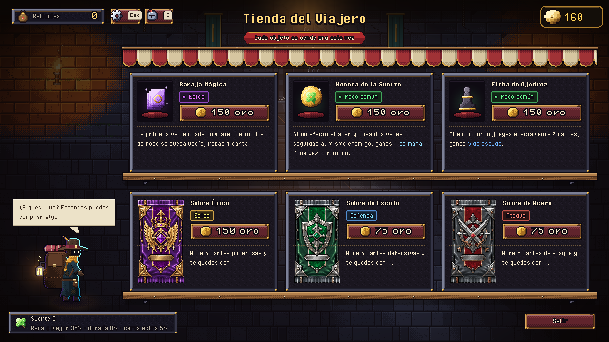

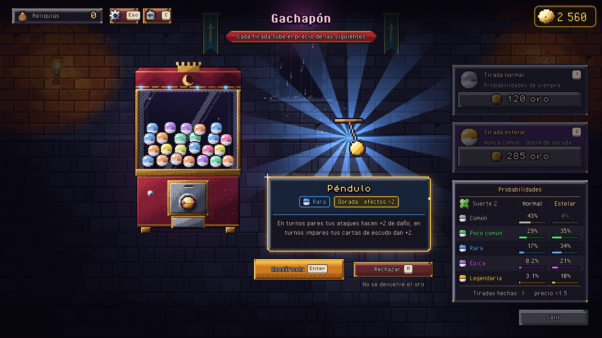

La sala del Brujo (04-11-2026) tiene su interfaz propia y a El Brujo animado junto a su caldero: tu mazo con el precio de
cada mejora como botón, la tarifa por rareza, «Ver mejoras» (V) y, al elegir una carta, un panel «Ahora → Mejorada» con lo
que cambia en fichas grandes. Al confirmar, El Brujo grita el conjuro, alza el bastón y un rayo verde convierte la carta.
Habla y reacciona como el Mercader (saluda, comenta, niega si falta oro, se acaricia la barba). Arte en
`Tools/VfxLab/warlock.html` (`python Tools/VfxLab/export_warlock_art.py [--check]`).

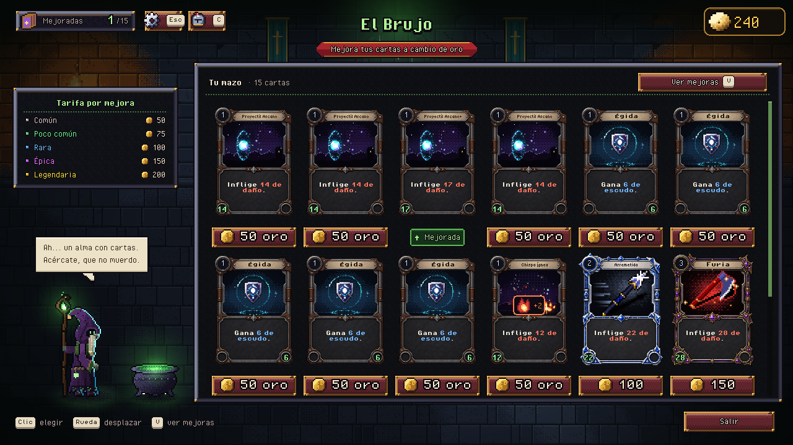

La sala del tesoro (07-11-2026) tiene su interfaz propia: un cofre dibujado por código que tiembla, se abre con un
destello dorado y deja subir las reliquias hasta sus tarjetas (la reliquia flotando en un nicho del color de su rareza, su
nombre, etiquetas de rareza, croma y clase, y su texto con los colores del glosario). Se elige con clic, 1–N o ← →, «Tomar»
(Enter) la lleva volando al contador de reliquias y «Omitir» (O) las deja todas; el Pico de Minero y la Ganzúa muestran el
oro que dieron.

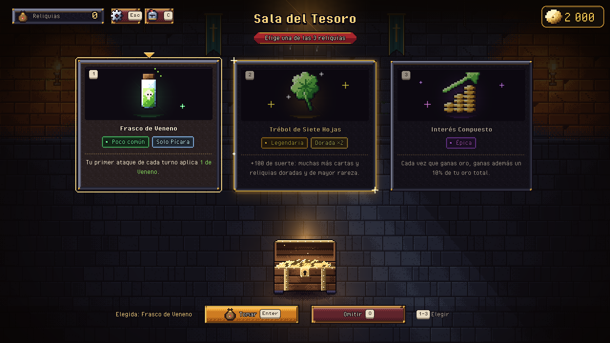

Cartas (04-11-2026): al pasar el ratón por una carta de la mano crece sin cambiar de texto (misma letra, mismas líneas,
mismo coste y daño; se dibuja al doble de resolución para que se vea nítida). La explicación de la carta es opaca, con el
nombre y el marco del color de su rareza y fichas con la rareza («Legendaria»…), el tipo y el coste; la clase va a la
derecha del nombre. En las recompensas y al abrir sobres cada carta lleva su rareza debajo.

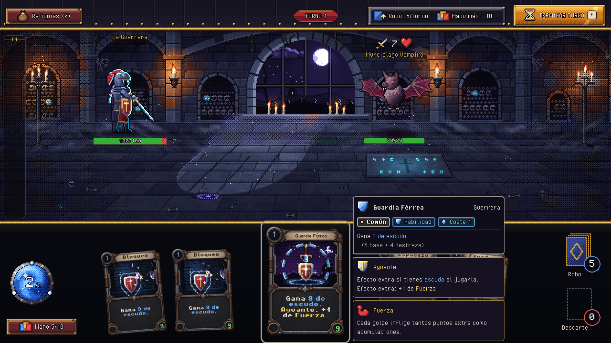

Recompensas por pasos (08-11-2026): al ganar, una fila de pasos bajo el título dice qué hay y por dónde vas —«Oro →
Carta» en combates normales, «Oro → Carta → Reliquia» en élites y «Oro → Sobre épico → Reliquia» en jefes— y cada paso sale
solo: el oro se cuenta y sus monedas vuelan al contador; un clic elige una carta y otro (o Enter) la añade al mazo, que
tiene su placa arriba a la izquierda, u «Omitir» (O); después la reliquia, que es opcional: «Tomar reliquia» (Enter) la
lleva al contador de reliquias y «Omitir» la deja. En los jefes el sobre épico se abre como siempre y la carta elegida
aparece en su paso; luego eliges una de las tres reliquias o ninguna.

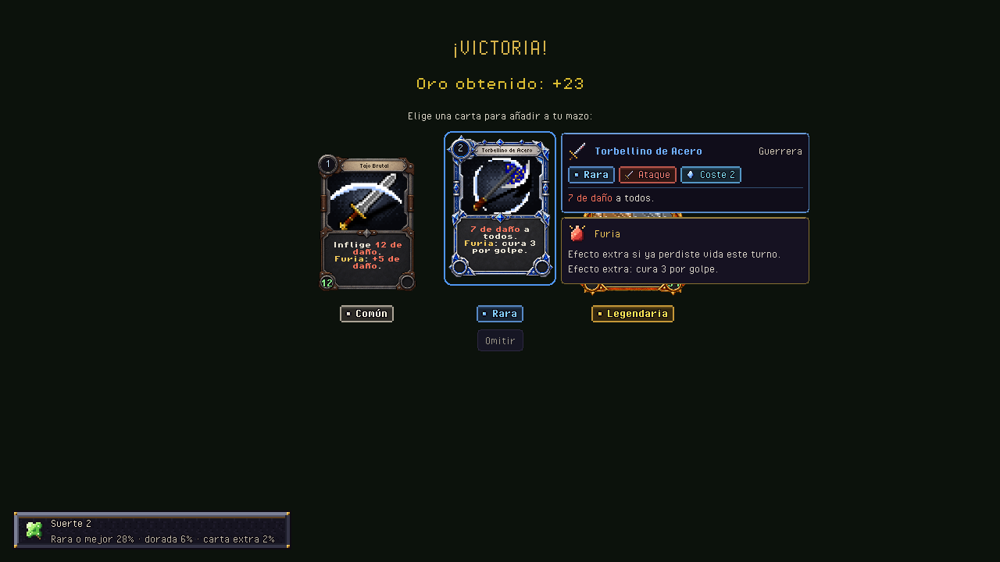

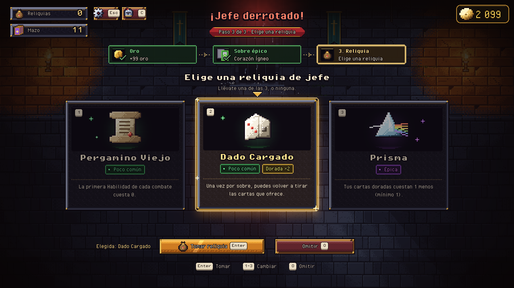

## Eventos con decisiones

Hay 150 eventos con decisiones, rarezas, restricciones por piso, vendedores extraños, sacrificios de vida y vida máxima, riesgos y 16 historias enlazadas; cuatro tienen finales alternativos. Algunos tienen varias decisiones en la misma sala. Se manejan con clic o ↑/↓, 1–3 y Enter. La lista completa, recompensas, enlaces y seguimiento de imágenes está en [docs/events.md](docs/events.md). La sala tiene su interfaz propia (04-11-2026): placa con un arco mágico dibujado por código, la historia en un panel, una tarjeta por opción con iconos de coste, recompensa y riesgo (al pasar el ratón se ve la carta o la reliquia en juego), opciones bloqueadas que dicen por qué y un resultado con lo que cambió. La ilustración propia de cada evento sigue pendiente en los 150.

Las historias que quedan abiertas se ven en el mapa (04-11-2026): un panel «Historias» a la izquierda del plano con cada historia pendiente, su capítulo y dónde sigue («En el próximo evento», «Tras la historia anterior» o «Desde el piso N»), y un pergamino sobre cada sala de evento donde puede aparecer el capítulo siguiente. Al elegir una opción que continúa, el resultado dice en qué piso sigue.

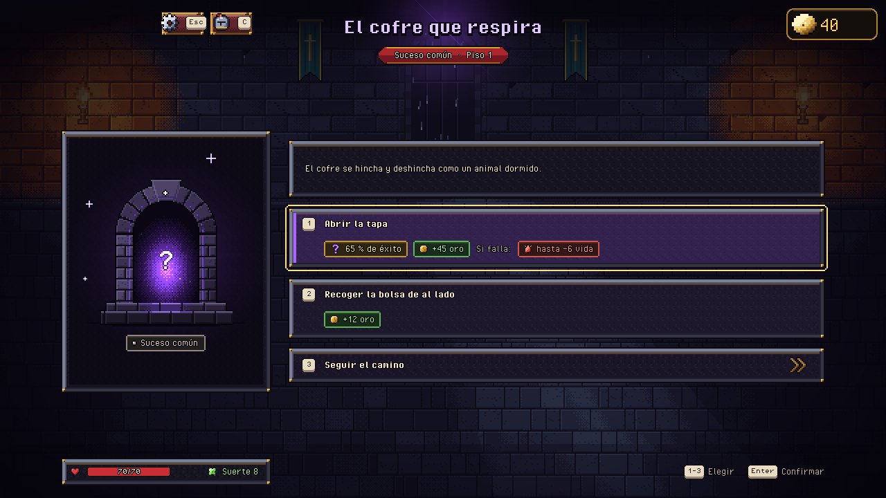

`python Tools/GenerateEvents.py --check` verifica que lista y programación coinciden con el catálogo editable.
