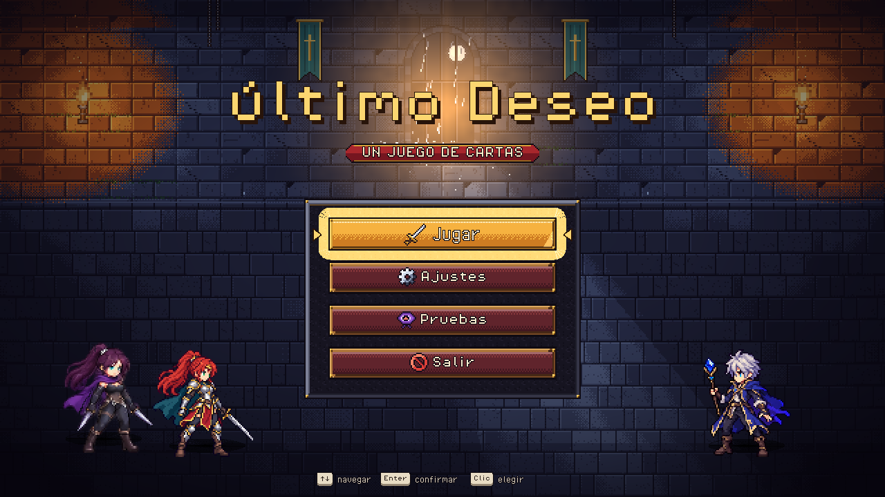
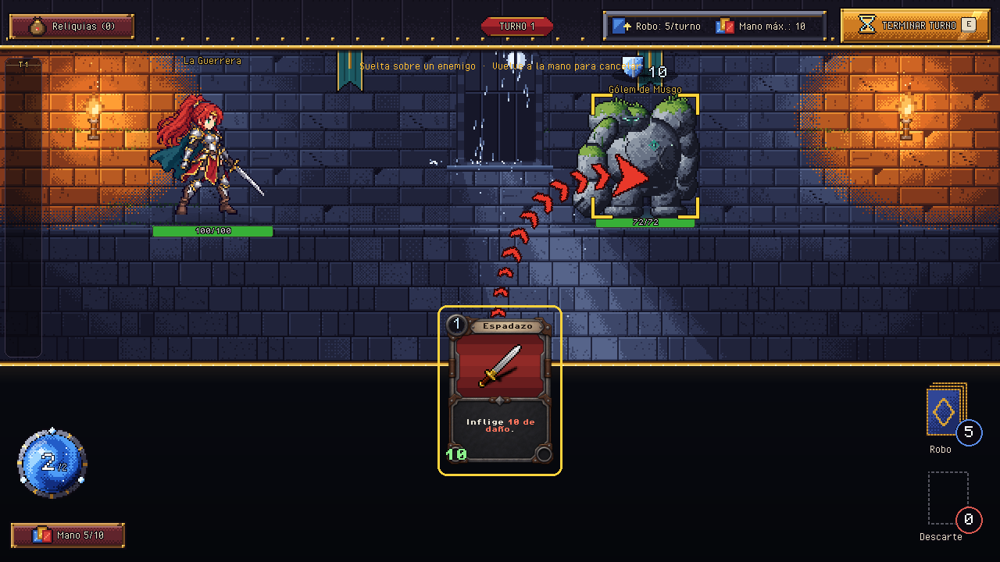
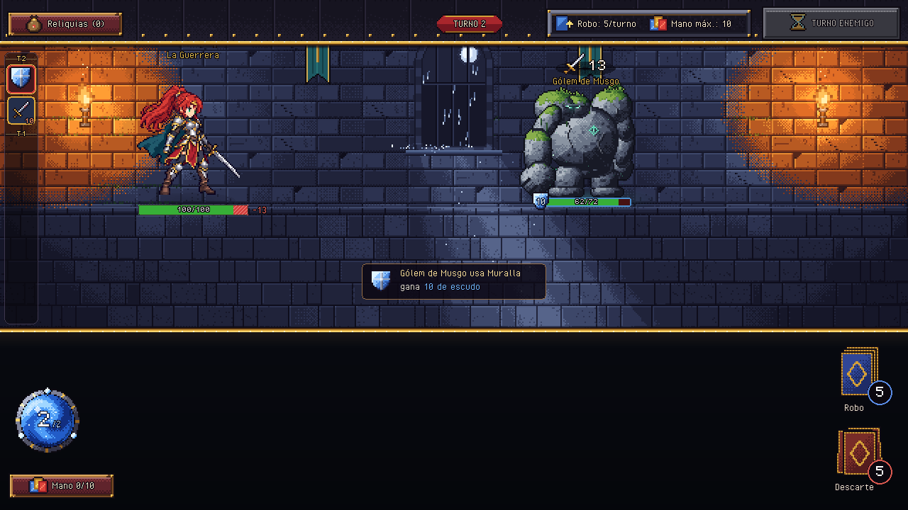
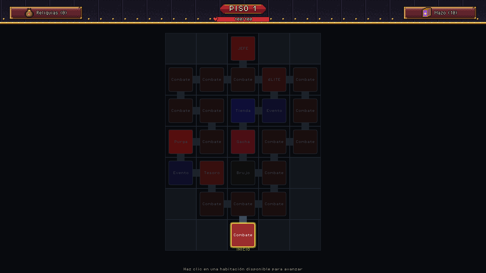
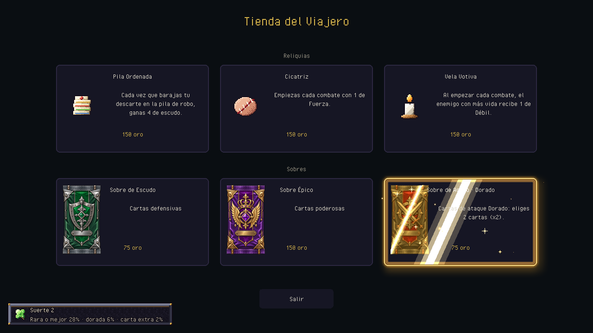
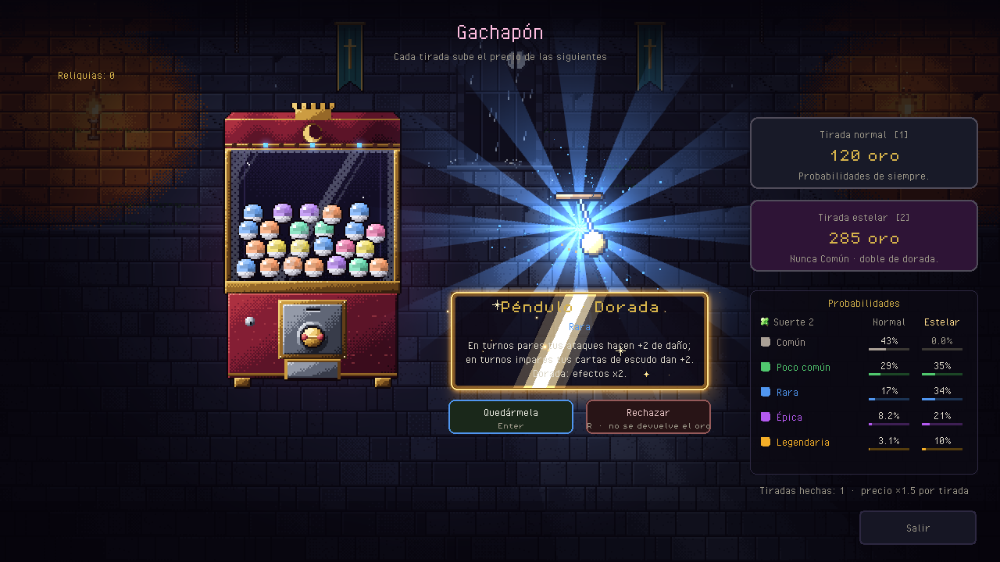

# Last Wish - Unity

**Último Deseo**, migrado desde el proyecto Python/Pygame a **Unity 6.3 LTS,
6000.3.6f1**. Todas las pantallas, reglas y efectos del original están portados a
C#; el estado y las diferencias conocidas están en `docs/port-status.md`.

## Abrir y jugar

1. Agrega esta carpeta (`C:/Users/USER/Desktop/web/unity/last-wish-unity`) en Unity Hub.
2. Ábrela con **6000.3.6f1** y espera la importación inicial.
3. Elige **Last Wish > Jugar** en el menú superior (abre `Assets/Scenes/Bootstrap.unity`
   y pulsa Play en la pestaña Game).

El juego se dibuja al ejecutarse: la pestaña **Scene** se ve vacía antes de Play.
La pantalla de carga aparece al pulsar Play o al abrir una build. El juego no
necesita Python.

## La partida

Igual que el original: menú (Jugar, Ajustes, Pruebas, Salir) → elegir personaje y
semilla → mapa por pisos con combate, élite, tesoro, tienda y sobres, suceso, Brujo,
gachapón, altar de purga y jefe → recompensas → siguiente piso. La vida, el oro, el
mazo y las reliquias pasan de sala en sala. Como en el original, no hay guardado:
**Pausa · Esc > Abandonar partida** vuelve al menú.

## Controles (los del original)

| Acción | Control |
|---|---|
| Jugar una carta | Arrastrarla fuera de la mano (o clic para sujetarla y clic de nuevo); sobre un enemigo si apunta a uno |
| Teclado | 1–9 toma una carta, ←/→/Tab cambia de objetivo, Enter/Espacio la juega |
| Cancelar | Clic derecho o Esc |
| Terminar turno | Botón o E |
| Ver todo de un enemigo / del héroe | Clic derecho, mantener pulsado o I |
| Elementos y reacciones (Mago) | Botón R o tecla R |
| Historial del combate | Tira de la izquierda: rueda, arrastrar o tocar |
| Hoja del héroe | Botón del casco o C |
| Pausa | Botón o Esc |
| Mostrar FPS | Ajustes |

## Estructura

```text
Assets/Scripts/Domain/        Reglas C# puras (sin UnityEngine): combate, cartas, reliquias, enemigos, run
Assets/Scripts/Presentation/  Escenas, UI y efectos del original sobre un lienzo virtual 1280×720 (C# puro)
Assets/Scripts/Runtime/       Unity: GameBootstrap (bucle de main.py), backend de dibujo, entrada, audio, archivos
Assets/Editor/                Importador de pixel art, configuración y build
Assets/Resources/Game/        PNG, metadatos, fuentes y audio originales
Assets/Scenes/Bootstrap.unity Escena de entrada
Assets/Tests/EditMode/        Reglas y paridad con el motor Python
Assets/Tests/PlayMode/        El juego completo con entrada simulada y capturas
Tools/                        Exportadores desde el repositorio Python y validación sin editor
```

El backend de Unity mete todo el frame en una sola malla dinámica (submallas solo
al cambiar de textura o de mezcla) ejecutada por un command buffer; las caras de
carta se componen una vez en texturas fuera de pantalla y se reutilizan, y el
lienzo se presenta escalado a la ventana con bandas negras como el `Viewport`
original. En estado estable no se reserva memoria por frame.

## Pruebas y build

En Unity: **Window > General > Test Runner**, pestañas EditMode y PlayMode. Las
pruebas PlayMode guardan capturas del lienzo en `TestResults/`.
**Last Wish > Build Windows** genera `Builds/Windows/LastWish.exe` (ignorado por Git).

```powershell
$editor = 'C:/Program Files/Unity/Hub/Editor/6000.3.6f1/Editor/Unity.exe'
$project = (Get-Location).Path
& $editor -batchmode -nographics -projectPath $project -executeMethod LastWish.Editor.ProjectSetup.Configure -quit -logFile Logs/import.log
& $editor -batchmode -nographics -projectPath $project -runTests -testPlatform EditMode -testResults TestResults/editmode.xml -logFile Logs/editmode.log
& $editor -batchmode -projectPath $project -runTests -testPlatform PlayMode -testResults TestResults/playmode.xml -logFile Logs/playmode.log
```

Los comandos de tests no llevan `-quit`: el Test Runner cierra el editor. Revisa
los XML y los logs, no solo el código de salida. `Tools/Validate.ps1` compila todo
contra las DLL de Unity y ejecuta los casos del dominio con .NET; no sustituye al
Test Runner.

Herramientas opcionales de migración (se ejecutan con el Python del repositorio original):

```powershell
python Tools/ExportPythonCatalog.py --source-dir RUTA_PYTHON --output docs/migration/python-catalog.json
python Tools/ExportNumericCards.py --source-dir RUTA_PYTHON --output-dir .
python Tools/ExportEnemyPatterns.py --source-dir RUTA_PYTHON --output-dir .
python Tools/ImportPythonAssets.py --source-dir RUTA_PYTHON
python Tools/ExportPresentationData.py --source-dir RUTA_PYTHON
python Tools/ExportCardFx.py --source-dir RUTA_PYTHON
python Tools/ExportPixelFonts.py --source-dir RUTA_PYTHON
```

El arte original se conserva sin redibujar. Consulta `THIRD_PARTY_NOTICES.md`.

## Capturas

Renderizadas con el verificador fuera de línea a partir de los mismos comandos de
dibujo que ejecuta Unity:












