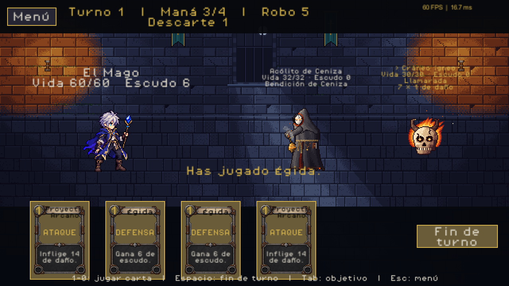
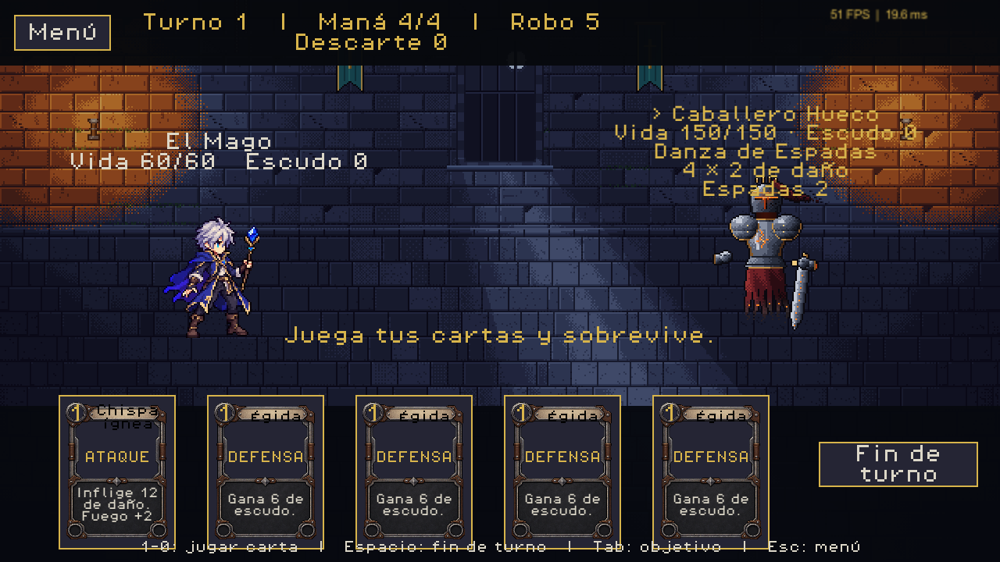
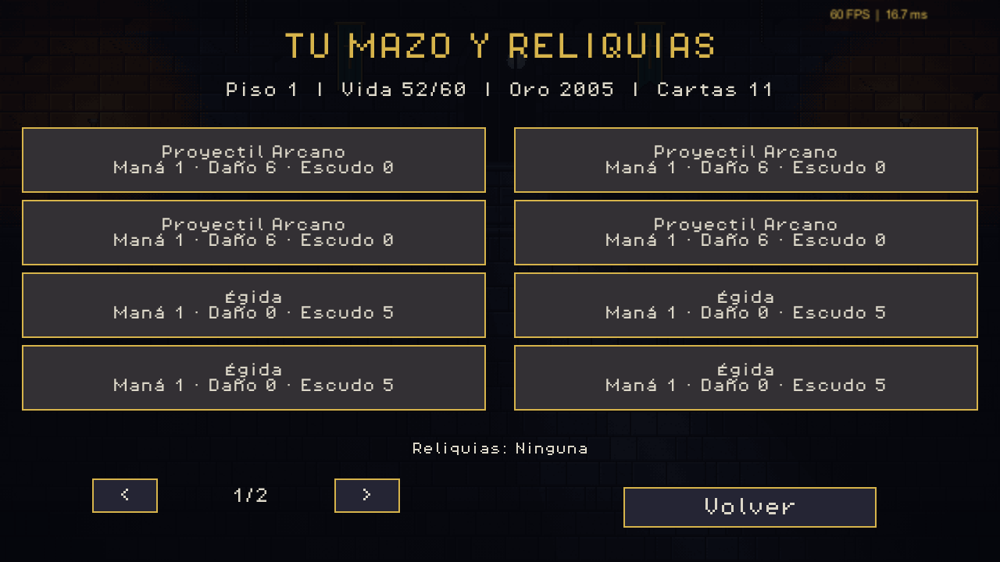

# Last Wish - Unity

Base jugable de **Último Deseo**, migrada desde el proyecto Python/Pygame a
**Unity 6.3 LTS, 6000.3.6f1**. La migración sigue en curso; consulta la cobertura exacta en `docs/port-status.md`.

## Abrir y jugar

1. Clona este repositorio y agrega su carpeta raíz en Unity Hub.
2. Ábrelo con **6000.3.6f1** y espera la importación inicial de paquetes y recursos.
3. Selecciona **Last Wish > Jugar** en el menú superior. Abre la escena inicial y activa Play en la pestaña Game.
4. Pulsa **Jugar**, elige personaje y comienza el combate.

La interfaz se crea al ejecutar el juego: la pestaña **Scene** puede verse vacía antes de Play. Para arrancar manualmente, abre `Assets/Scenes/Bootstrap.unity`, pulsa ▶ **Play** y cambia a **Game**. El editor usa vista 2D y el botón Play inicia siempre Bootstrap, aunque estés en una escena vacía.

Unity Hub debe tener una licencia activa. La primera importación del editor
puede tardar; la pantalla de carga del juego aparece al pulsar Play o ejecutar
una build, no durante la importación de Unity Hub.

## Carpeta independiente

Este repositorio vive separado del juego Python. La copia local se encuentra en
`C:/Users/USER/Desktop/web/unity/last-wish-unity`. Agrega **esa carpeta** a Unity
Hub; elimina de la lista de Hub la entrada anterior que terminaba en `last-wish/unity`.
El juego no necesita Python instalado para ejecutarse.

## Partida migrada

Jugar > elegir personaje abre el mapa. Elige la sala disponible y completa sus
acciones para desbloquear caminos. La vida, el oro, el mazo y las reliquias se
conservan entre salas. Hay tienda con sobres, apertura de sobres, tesoro,
suceso, Brujo, purga, gachapón, recompensas y avance de piso tras el jefe.
Mazo y reliquias abre el inventario paginado.

El guardado es un **punto de control entre salas**: al volver al mapa se guarda
en `Application.persistentDataPath/run-v1.json`, con respaldo y validación de
versión. Continuar partida carga ese punto de control. Un combate en curso
no se guarda turno por turno; al reiniciar se vuelve al último mapa guardado.

## Incluido

- Pantalla de carga con progreso de recursos mediante `Resources.LoadAsync`.
- Menú, ajustes de FPS, selección de guerrera/mago/pícara.
- Mazmorra y sprites actuales del proyecto original, con animaciones de idle,
  ataque, defensa, daño y derrota. Se conservan los tiempos de los atlas.
- Combate contra el catálogo original: 11 enemigos normales, 5 élites, 3 jefes,
  parejas y tríos; selección de objetivo, intenciones, estados y seis reacciones elementales.
- Las 165 cartas del catálogo: condiciones, efectos de área, poderes persistentes,
  curación, autocoste de vida, dagas automáticas y efectos de descarte.
- Mazo inicial, mano, maná, daño, escudo, robo, descarte y reciclado del mazo.
- Victoria, derrota, volver al menú y repetir batalla.
- Música original, efectos y UI en español.
- Lienzo de referencia 1280x720 adaptable a la ventana, texturas pixel-art sin
  mipmaps ni compresión y filtrado Point en los personajes.
- Cálculo de daño con `BigInteger`: `(base + bonos planos) * multiplicadores`.
- Escena inicial, ajustes de proyecto y `.meta` incluidos en Git.

## Controles

| Acción | Control |
|---|---|
| Jugar carta | Clic o teclas 1-9 y 0 (décima) |
| Elegir enemigo | Clic en su zona; Tab siguiente / Q anterior |
| Terminar turno | Botón o Espacio |
| Volver al menú durante combate | Botón Menú o Esc |
| Mostrar FPS y milisegundos | Menú > Ajustes |

El Input System también configura navegación de UI con mando; hombros cambian
objetivo, botón oeste termina turno y Start vuelve al menú. Las pruebas automáticas
comprueban teclado y ratón; el mando físico aún requiere validación.

Mientras se resuelve una animación, las acciones se bloquean para evitar jugar
cartas dos veces. Se usa la semilla 42 en esta demo para reproducir las partidas.

## Estructura

```text
Assets/Scripts/Domain/        Reglas C# puras, sin UnityEngine
Assets/Scripts/Application/   Comandos de la sesión de combate
Assets/Scripts/Runtime/       Canvas, carga, animaciones y presentación
Assets/Editor/                Importadores y configuración/build
Assets/Resources/Game/        Arte, metadatos, fuentes y audio seleccionados
Assets/Scenes/Bootstrap.unity Escena de entrada
Assets/Tests/EditMode/        Pruebas de reglas y números grandes
Assets/Tests/PlayMode/        Prueba de carga > menú > selección > combate
Tools/                       Validación adicional sin arrancar el editor
```

La UI se construye con componentes uGUI al iniciar. El proyecto usa el renderizador
Built-in y **Input System 1.17.0** con `InputSystemUIInputModule`.
Active Input Handling está en **Input System Package (New)**; no requiere la entrada clásica.
Las actualizaciones del HUD ocurren al cambiar el combate; las animaciones cambian
el UV del atlas sin crear imágenes ni recortar texturas cada frame.

## Pruebas y build

En Unity: **Window > General > Test Runner**, pestañas EditMode y PlayMode.
**Last Wish > Configure project** aplica la configuración base; **Last Wish >
Build Windows** genera `Builds/Windows/LastWish.exe` (ignorado por Git).

PowerShell, reemplazando las rutas del editor y proyecto si es necesario:

```powershell
$editor = 'C:/Program Files/Unity/Hub/Editor/6000.3.6f1/Editor/Unity.exe'
$project = (Get-Location).Path
& $editor -batchmode -nographics -projectPath $project -executeMethod LastWish.Editor.ProjectSetup.Configure -quit -logFile Logs/import.log
& $editor -batchmode -nographics -projectPath $project -runTests -testPlatform EditMode -testResults TestResults/editmode.xml -logFile Logs/editmode.log
& $editor -batchmode -projectPath $project -runTests -testPlatform PlayMode -testResults TestResults/playmode.xml -logFile Logs/playmode.log
```

Los comandos de tests no llevan `-quit`: el Test Runner cierra el editor.
En Windows espera a que termine el proceso antes de abrir otro editor del mismo
proyecto. Los resultados de pruebas, capturas, builds y cachés están ignorados.

Para compilar C# contra las bibliotecas locales sin abrir Unity y ejecutar los
casos NUnit del dominio con .NET 9, usa `Tools/Validate.ps1`. Esta validación no
sustituye al Test Runner ni comprueba el renderizado de Unity.

## Cobertura y pendientes

Los tres personajes usan sus estadísticas y mazos originales. Se migraron las
**165 cartas del catálogo** y los **19 patrones de enemigos**, incluidos élites,
jefes y encuentros múltiples. Hay 326 comparaciones de resolución de cartas,
92 comprobaciones de poderes durante varios turnos y 1,368 intenciones comparadas
contra el motor Python. Esto no equivale a cobertura exhaustiva de cada combinación.

Las reliquias siguen en **8 de 156**. Aún faltan sus otros 148 efectos, cromas,
fusión/rotura de cartas, elecciones especiales de mazo, sucesos completos y Pruebas.
El guardado sigue siendo entre salas. El RNG de C# conserva las reglas de
selección, pero una semilla no reproduce exactamente los resultados de Python.
La migración completa sigue pendiente; la lista precisa está en
[docs/port-status.md](docs/port-status.md).

Se midió la build final de Windows antes/después de reutilizar la UI de cartas:
la mediana de un refresco sin cambios pasó de **3.0443 a 0.0301 ms**, y el GC del
frame de refresco de **635,324 a 1,640 bytes**. El límite continúa en unos 60 FPS.
Consulta [método, límites y datos](docs/performance/README.md).

Herramientas opcionales de migración (el juego no necesita Python):

```powershell
# Ejecutar con el Python/venv del repositorio original; ajustar RUTA_PYTHON.
python Tools/ExportPythonCatalog.py --source-dir RUTA_PYTHON --output docs/migration/python-catalog.json
python Tools/ExportNumericCards.py --source-dir RUTA_PYTHON --output-dir .
python Tools/ExportEnemyPatterns.py --source-dir RUTA_PYTHON --output-dir .
python Tools/ImportEnemyArt.py --source-dir RUTA_PYTHON --output-dir .
```

Los exportadores generan C# y expectativas contra la ejecución del motor Python;
no ejecutan callbacks Python durante el juego. El nombre histórico `NumericCards`
ahora incluye también comandos nativos y poderes. Los PNG enemigos se copian sin
alterar sus píxeles; se conserva el tiempo de cada frame y el anclaje original.

El arte original y los atlas se conservan. Consulta `THIRD_PARTY_NOTICES.md`.

Validación de este cambio: **72/72 EditMode**, **7/7 PlayMode** y build Windows
correcta. PlayMode comprueba input real simulado, los 19 atlas, encuentros
múltiples, reutilización de botones y guardado JSON de las 165 cartas.

## Capturas de Unity








